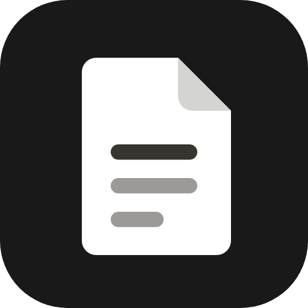

# Visor de notas

Visor de archivos Markdown y texto con un diseño minimalista inspirado en Notion. Es un solo archivo HTML que funciona sin internet y no depende de librerías externas.

**Úsalo en línea:** https://yefersonv5.github.io/visor-de-notas/

## Cómo usarlo

1. Abre el enlace de arriba, o descarga `index.html` y ábrelo con doble clic para usarlo sin internet.
2. Arrastra tus archivos a la ventana, usa **Abrir archivos** (`Ctrl O`) o pega texto (`Ctrl V`).

## Qué hace

- Markdown completo: títulos, listas anidadas, tareas, tablas, código, citas, enlaces e imágenes.
- Compatible con Obsidian: propiedades YAML, cuadros `> [!NOTE]`, `==resaltado==` y enlaces `[[Nota]]` entre archivos abiertos.
- Compatible con Pandoc: etiquetas `<badge>`, marcas `{=html}`, `[texto]{.underline}` y `[texto]{.mark}`.
- CSV como tabla (detecta `;` o `,`), JSON con formato y colores, TXT y LOG con números de línea.
- Índice automático, búsqueda dentro del documento, tema claro y oscuro, estilos de letra Predeterminado, Serif y Mono, tamaño de letra y ancho completo.
- Abre bien archivos guardados en Windows con otra codificación (tildes y ñ).
- Recuerda los archivos abiertos y tus ajustes en el navegador.

## Atajos

| Acción | Atajo |
|:--|:--|
| Abrir archivos | `Ctrl O` |
| Buscar | `Ctrl F` |
| Pegar texto | `Ctrl V` |
| Mostrar u ocultar barra lateral | `Ctrl \` |
